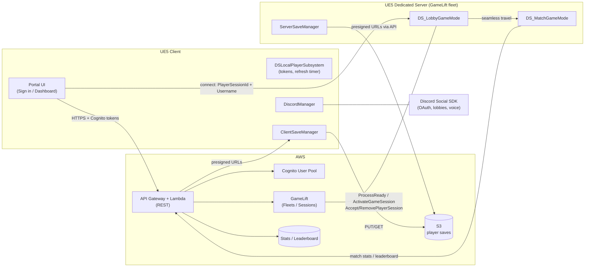

# UE5 GameLift Dedicated Servers

An Unreal Engine 5.5 C++ module that runs a game's whole online flow on **Amazon GameLift**: sign-in with **AWS Cognito**, session discovery and matchmaking through a **REST API (API Gateway + Lambda)**, a dedicated-server lobby and match lifecycle, player saves in the cloud on **S3**, and **Discord Social SDK** lobbies with voice.

> **About this code:** the base architecture comes from Druid Mechanics' course [*Unreal Engine 5 Dedicated Servers with AWS and GameLift*](https://www.udemy.com/course/unreal-engine-5-dedicated-servers-with-aws-and-gamelift/). I adapted it to my own needs and **extended it heavily**: it grew from roughly 5k to 9k+ lines across 100+ source files. The backend (Lambda/infrastructure) is not included. [What I built on top of the course](#what-i-built-on-top-of-the-course) lists my changes.

---

## Contents
- [Architecture](#architecture)
- [What I built on top of the course](#what-i-built-on-top-of-the-course)
- [Code tour](#code-tour)
- [Player flow, end to end](#player-flow-end-to-end)
- [Using the module](#using-the-module)
- [Known limitations / next steps](#known-limitations--next-steps)

---

## Architecture



There are two separate network paths:
1. **Control plane (HTTPS):** the client never talks to GameLift directly. Every request (sign-in, list fleets, find or create a game session, create a player session, stats, save URLs) goes through a REST API that holds the AWS credentials.
2. **Game traffic (UE replication):** the client connects to the dedicated server with its `PlayerSessionId`. The server checks that ID with GameLift before letting the player in.

No endpoints, keys or IDs are hard-coded. The API URL and stage live in a `UAPIData` Data Asset. GameLift Anywhere settings (`-fleetid`, `-hostid`, `-authtoken`, `-websocketurl`, `-port`) come from the command line. The Discord app ID and the save-manager classes are set in **Project Settings → Dedicated Server Game Settings**.

---

## What I built on top of the course

| Area | What I added |
|---|---|
| **S3 save system** | Abstract `USaveManagerBase` with **client** and **server** versions. Saves are turned into bytes with `FObjectAndNameAsStringProxyArchive`, then uploaded or downloaded through **presigned S3 URLs** handed out by the API, and confirmed with the API afterwards. The client version uploads two save objects at once (player + home area) and waits for both. |
| **Server saves for several players at once** | `UServerSaveManager` tracks one in-progress operation per player (`TMap<FString, FServerAsyncOperationData>`). It also maps each in-flight `FHttpRequestPtr` back to its player, so responses that arrive out of order go to the right player. |
| **Save before travel** | `UPlayerTravelComponent`: the client asks the server to save (`Server_RequestSavePlayerData`, reliable and validated), the server saves to S3, then tells the client it's done (`Client_OnSavePlayerDataComplete`). Only then does the client travel. `UGamePage` picks the right save path based on where the player is (dedicated server, local home area, or the portal). |
| **Multiple destinations** | The dashboard can send players to a local home-area level or to separate GameLift session types (`RAID`, `TOWN`). Each one goes through its own find-or-create-session request. |
| **Discord Social SDK** | `UDiscordManager` (a local-player subsystem): OAuth2 sign-in with PKCE, token exchange, joining and leaving lobbies, keeping a member list up to date, voice "who's speaking" events, and rich presence. All of it is exposed to Blueprint through delegates, along with a lobby actor and a UMG widget. |
| **Auth / account** | Forgot-password and confirm-forgot-password flows, a shared `BaseValidationPage` that the sign-up and reset forms reuse, Cognito token refresh on a timer, and remember-me. |
| **Configurable from Project Settings** | `UDSGameSettings` (`UDeveloperSettings`) lets you swap the client and server save-manager classes and set the Discord app ID without changing code. |
| **Server lifecycle** | `DS_MatchGameState`, a shared `InitNewPlayer` that sets usernames and display names after travel, and a check that cleans up once every player has left. |

---

## Code tour

All paths are under `Source/DedicatedServers/`.

**GameLift server integration**
- [`Game/DS_GameInstanceSubsystem`](Source/DedicatedServers/Private/Game/DS_GameInstanceSubsystem.cpp): sets up the GameLift Server SDK once per process (`InitSDK`, then `ProcessReady` with the `OnStartGameSession`, `OnTerminate` and `OnHealthCheck` callbacks, plus log paths and the port from the command line).
- [`Game/DS_GameModeBase`](Source/DedicatedServers/Private/Game/DS_GameModeBase.cpp): reads the GameLift Anywhere settings, runs the countdown timers that are replicated to clients, handles seamless travel, and calls `RemovePlayerSession` when a player leaves.
- [`Game/DS_LobbyGameMode`](Source/DedicatedServers/Private/Game/DS_LobbyGameMode.cpp): **`PreLogin` checks each player with GameLift**: `DescribePlayerSessions`, then it requires the session to be `RESERVED` and to belong to that username, then `AcceptPlayerSession`. It also tracks lobby state and runs the countdown to seamless travel.
- [`Game/DS_MatchGameMode`](Source/DedicatedServers/Private/Game/DS_MatchGameMode.cpp): the match moves from pre-match to match to post-match, turns client input on or off, records stats and the leaderboard, then sends everyone back to the lobby.

**REST / HTTP layer**
- [`UI/HTTP/HTTPRequestManager`](Source/DedicatedServers/Private/UI/HTTP/HTTPRequestManager.cpp): the shared base class. It turns parameters into JSON and spots both Lambda errors (`errorType`) and AWS SDK errors (`$fault`).
- [`Data/API/APIData`](Source/DedicatedServers/Public/Data/API/APIData.h): endpoints are found by **gameplay tag** (`DedicatedServerTags.PortalAPI.SignIn`, and so on), so moving to another API is a data change, not a code change.
- [`UI/Portal/PortalManager`](Source/DedicatedServers/Private/UI/Portal/PortalManager.cpp), [`UI/GameSessions/GameSessionsManager`](Source/DedicatedServers/Private/UI/GameSessions/GameSessionsManager.cpp), [`UI/GameStats/GameStatsManager`](Source/DedicatedServers/Private/UI/GameStats/GameStatsManager.cpp): one class each for auth, sessions and stats.

**Saves:** [`Save/`](Source/DedicatedServers/Private/Save), [`Player/PlayerTravelComponent`](Source/DedicatedServers/Public/Player/PlayerTravelComponent.h)

**Discord:** [`Discord/`](Source/DedicatedServers/Private/Discord)

**UI:** Portal sign-in, sign-up, confirm and forgot-password pages, the dashboard (game, career and leaderboard pages), lobby player list, and timers. All are UMG widgets driven from C++ with `BindWidget`, so designers own the layout and C++ owns the behaviour.

---

## Player flow, end to end

1. **Sign in:** `PortalManager` → `POST /signin` → Cognito tokens stored in `DSLocalPlayerSubsystem`, with a refresh scheduled before they expire.
2. **Load profile:** `ClientSaveManager` asks for download URLs, then fetches the player and home-area saves from S3 in parallel.
3. **Pick a destination:** the dashboard either opens the local home-area level, or calls `FindOrCreateGameSession`, then `CreatePlayerSession`, then `OpenLevel(ip:port, "?PlayerSessionId=…?Username=…")`.
4. **Lobby:** the server checks the player session with GameLift in `PreLogin`. Once enough players are in, a countdown starts, followed by **seamless travel** to the match map.
5. **Match:** timers run on the server and are replicated to clients. At the end, stats are recorded and the leaderboard is updated through the API.
6. **Leave:** before travelling, the server saves the player's state to S3 and confirms to the client. GameLift player sessions are removed when the player logs out.

---

## Using the module

This repo contains only the `DedicatedServers` runtime module (no project, content or backend).

**Requirements**
- Unreal Engine **5.5**, built from source (needed for Server targets)
- [Amazon GameLift Plugin for Unreal](https://github.com/amazon-gamelift/amazon-gamelift-plugin-unreal) (`GameLiftServerSDK`)
- Discord Social SDK Unreal plugin (`DiscordPartnerSDK`), only if you keep the `Discord/` folder
- Your own REST backend (API Gateway + Lambda + Cognito + GameLift + S3)

**Steps**
1. Copy `Source/DedicatedServers` into your project's `Source/` folder.
2. Add the module to your `.uproject`:
   ```json
   { "Name": "DedicatedServers", "Type": "Runtime", "LoadingPhase": "Default" }
   ```
3. Add Client and Server targets (`<Project>Client.Target.cs` and `<Project>Server.Target.cs`) and add `DedicatedServers` to `ExtraModuleNames`. The GameLift plugin sets `WITH_GAMELIFT=1` for Server targets, so GameLift calls are only compiled into server builds.
4. Create a `UAPIData` Data Asset for each API (invoke URL, stage, and a tag-to-resource map) and assign it to the HTTP manager Blueprints.
5. In **Project Settings → Dedicated Server Game Settings**, set the save-manager classes and (optionally) the Discord Application ID.
6. Launch the server, e.g. for GameLift Anywhere:
   ```
   <Project>Server.exe -port=7777 -fleetid=<id> -hostid=<compute> -websocketurl=<wss://...> -authtoken=<token>
   ```

---

## Known limitations / next steps
- **Remember-me** currently keeps a scrambled password in a local `SaveGame`. A better design is to keep only the Cognito refresh token, in the operating system's secure credential storage.
- Auth tokens are masked in logs, but the debug `Dump()` helpers should be compiled out of Shipping builds.
- The backend (Lambda functions, IAM, infrastructure as code) is not in this repo.
- No automated tests yet. Good candidates are the JSON response parsing and the save serialisation round-trip.

---

## Tech
`C++17` · `Unreal Engine 5.5` · `Amazon GameLift Server SDK` · `AWS Cognito` · `API Gateway / Lambda` · `S3 presigned URLs` · `Discord Social SDK` · `UMG` · `Gameplay Tags` · `UDeveloperSettings` · Replication / RPCs · Seamless travel

**Author:** Taher Samadi Shal ([@tataunlimited](https://github.com/tataunlimited))
